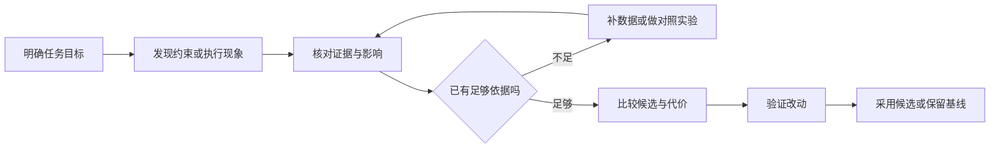

# Hardware-Native：从硬件事实到开发决策的体验设计方向

> 面向：UX 设计、产品、框架、编译器与开发工具团队  
> 日期：2026-10-31  
> 文档性质：研究与方向论证，含设计建议；不代表功能已经实现，也不代表本轮完成了设备实验或用户测试。  
> 研究范围：昇腾上的模型与算子开发，重点使用 hw-native-sys 社区 PyPTO/PTO 相关案例，并参考昇腾官方与其他加速器生态资料。

> 汇报定位补充：本文作为整个 UX 项目阶段性汇报的研究与证据底稿。用于前段洞察输出的精简主线见 [Hardware-Native 阶段汇报洞察与机会分析](./PyPTO3.0_体验设计项目材料包/Hardware-Native_阶段汇报洞察与机会分析_20261031.md)：重点论证命题必要性、提炼工具探索机会，并衔接后续设计方案。

## 阅读导航

- **用于项目阶段汇报**：先读配套 8 页洞察与机会分析稿；推导见本文第 1、3.4、6.8、7.7 节，案例与边界见第 6、12 节，业界参考见第 9 节。
- **用于理解领域与梳理对象**：读第 2、3、5 节。
- **用于设计场景和原型**：读第 6、7、8 节。
- **用于竞品与方法借鉴**：读第 9 节。
- **用于核查证据**：读第 12 节及来源索引。

## 1. 结论：值得投入的方向，以及目前能证明到哪里

### 1.1 建议提出的设计方向

**让影响正确性、可执行性和性能的目标硬件事实，在开发者做选择时可获得、可理解、可操作、可验证。**

对 UX 团队，更具体的任务是：连接用户的开发意图、框架与编译器的处理、实际设备行为，以及下一步操作。用户不必掌握全部微架构知识，但不应在关键选择上只能猜测。

在昇腾场景中，将方向落实为四类具体开发决定：**O1 面向 AIC／AIV 协同的计算分工设计；O2 面向片上存储的 Tile 形态与资源设计；O3 面向 Cube／Vector 交接的数据路径与融合设计；O4 面向多流水协同的并行与同步设计。**

四类决定分别回答谁来算、数据怎样放、数据怎样走、执行怎样衔接。它们共同构成“面向目标硬件的开发决策体验”，不要求建设四个独立页面。

“约束前移、映射解释、影响分析、实验比较”属于贯穿四个机会的通用设计方法。领域独特性应由昇腾架构及编程约定对对象、检查规则、可选操作和验证要求的实际影响来证明，不能只靠硬件名词。

### 1.2 核心论证链

**昇腾硬件机制 → 受影响的开发对象 → 必须作出的选择 → 案例中的判断困难 → 四个领域机会 → 任务验证。**

| 论证环节 | 当前依据 | 可支持的结论 | 不应推导出的结论 |
| --- | --- | --- | --- |
| 昇腾机制改变实现选择 | AIC／AIV、专用存储、代际通路和异步流水资料 | 分工、分块、融合和时序要满足目标条件 | 所有代际相同，所有细节都需手动控制 |
| 选择落实到具体开发对象 | 计算区域、有效 Tile、Right/Vec、FIFO、屏障参与者 | 可以围绕对象解释作用范围和后果 | 加硬件图就已支持决策 |
| 实际记录暴露判断困难 | CSA、容量、FIFO、同步案例 | 存在可具体描述的关联与行动需求 | 历史问题今天仍存在，或代表普遍频率 |
| 从困难收敛领域机会 | O1 计算分工、O2 Tile 资源、O3 路径与融合、O4 并行同步 | 形成可验证的任务与产品探索 | 四个机会证据同等充分、已经交付 |
| 框架与 UX 共同承载 | 自动检查、策略生成、对象映射、实验机制 | 自动处理与必要解释、控制可以共存 | 用界面替代技术修复 |
| 通过任务核验价值 | 本文研究计划与否定条件 | 值得聚焦试点并逐步扩展 | 已证明最高优先级或量化收益 |

**证据强度不相同。** O1、O2、O4 已有具体技术产物或开发记录支撑；O3 具有明确架构依据，真实融合决策任务的用户证据仍需补充。七个案例也不能证明全部机会的发生率或优先级。

**当前证据支持将 Hardware-Native 列为体验设计的重要方向之一，并投入试点；尚不足以证明某个页面已经带来收益。**

### 1.3 为什么这是体验设计问题

技术系统负责正确执行和提供可靠数据。UX 负责让人能够在正确时机理解系统、进行干预、比较取舍并确认结果。两者必须协作：

1. **用户意图能否表达**：选择 tile、切分、数据生命周期时，能否看出作用范围和限制。
2. **系统判断能否理解**：编译器拒绝、降级或改变实现时，能否回到用户的代码与目标。
3. **下一步能否执行**：用户应改参数、改代码、换实现、换版本，还是先补证据。
4. **结果能否可信**：优化的是局部还是整图；观察来自估算、编译还是设备；比较条件是否一致。

这些是交互、信息架构、反馈与信任设计问题。单纯改善措辞无法修复编译器缺陷，但可靠的底层能力也不会自动形成可用体验。

## 2. 什么是 Hardware-Native

### 2.1 技术定义与体验定义

hw-native-sys 将底层硬件架构意识作为系统软件设计的重要原则。这是一种跨编译器、运行时和 kernel 的设计取向，而非一个统一认证标准。[S01]

**本文工作定义**：Hardware-Native 是软件系统在抽象、映射、调度和执行时，尊重目标硬件的能力、限制与成本，并为必要的干预和验证保留通路。

**体验层定义**：当硬件事实会改变用户当前选择时，系统应当让它进入任务流程，形成“我知道为什么、可以改变什么、如何确认”的能力。

例如，用户增加一个模型维度，最终触发片上容量不足。硬件事实是有限的片上空间；系统事实是本次编译的分配；体验问题是开发者能否据此找到正确分块轴，而不必试遍所有参数。

### 2.2 与相近概念的关系

| 概念 | 主要回答 | 与 Hardware-Native 的关系 |
| --- | --- | --- |
| 硬件兼容 | 能不能运行、接口是否支持 | 运行是基础；还要考虑映射、成本与结果 |
| 硬件感知 | 系统是否知道硬件信息 | 知道信息之后，仍需用于处理或决策 |
| 硬件亲和优化 | 实现是否适合目标设备 | 是重要结果；需要解释适用条件并验证收益 |
| 可观测性 | 发生了什么，证据在哪里 | 为运行验证提供基础；还需关联意图与可操作选择 |
| Hardware-Native | 硬件事实怎样进入软件设计与开发决策 | 同时涉及表达、自动处理、约束、解释和观测 |

这里的区分是产品分析框架，不是对这些术语作行业唯一的定义。

### 2.3 抽象与硬件原生可以同时成立

昇腾官方将 TPipe/TQue 用于资源、通信与同步管理，以队列和资源操作承载底层复杂性；Gluon 则为需要更细控制的开发者显式开放布局等能力。两类机制都说明，抽象程度应当随任务变化。[S02][S11]

因此，不能用“用户看到了多少硬件细节”衡量 Hardware-Native。更合适的三种处理方式是：

- **系统可靠地自动处理**：默认完成，按需解释。
- **用户必须作出选择**：给出可行范围、代价、影响和验证方法。
- **系统尚不能确定**：展示不确定性，组织验证，避免输出确定性建议。

### 2.4 哪些事情不属于本方向

- 无目标设备或执行语义关联的普通编辑器、项目管理、登录体验。
- 只增加芯片图、硬件术语和资源仪表盘，但不支持理解、操作或验证。
- 把所有软件 bug 都归因于“缺少硬件意识”。
- 把本应由框架保证的正确性转交给用户记忆和检查。
- 以某块资源是否用满代替任务是否更快、结果是否正确。

## 3. 在昇腾体系中的价值：硬件能力如何成为可交付结果

### 3.1 沿开发链路看职责

下表按职责组织，不代表所有产品都经过同一条实现路径。社区 PyPTO 案例不能直接等同于全部 CANN、Ascend C 或昇腾商业软件的现状。

| 层次 | 典型对象 | 需要解决的 Hardware-Native 问题 | 对用户的价值 |
| --- | --- | --- | --- |
| 模型与服务 | 模型层、prefill/decode、并行方案、KV Cache、精度目标 | 负载怎样使用设备、存储与互连 | 确认方案可行，并选择值得优化的环节 |
| 编程框架与算子库 | Tensor、Tile、scope、算子实现、分块和切分策略 | 哪些意图可表达，哪些由系统自动完成 | 减少必须手写和必须记忆的规则 |
| 编译与后端 | IR、layout、buffer、同步、生成 kernel | 软件意图如何变为合法且有效的目标实现 | 更早发现问题，解释自动决策与实现差异 |
| 运行时与通信 | 派发、依赖、Host/Device buffer、rank、通信资源 | 资源生命周期、任务执行与跨卡协作 | 避免重复搬运、无效等待与不可复现的运行 |
| 设备与采集 | AIC/AIV、存储层级、搬运、时序与计数器 | 实际执行是否符合意图 | 用设备证据验证正确性与收益 |
| 工具与体验 | 诊断、报告、视图、实验与回归 | 如何把跨层证据交给人 | 缩短定位、决策和验证路径 |

昇腾官方资料说明了 AIC/Cube、AIV/Vector 及异构编程结构，也通过编程框架管理部分复杂性；本文使用这些概念，不把某一代的核数、容量和通路推广到所有芯片。[S02][S03]

### 3.2 四种核心价值

**正确性与可执行性。** 对可判定的约束提前检查；对不能静态保证的部分明确验证范围。价值包括避免设备超时、静默错误和反复上板，而不只是加速。

**性能可实现性。** 将布局、数据搬运、分工、流水和驻留策略连接到可测量结果。用户需要知道性能受什么限制、改动是否会触及关键路径。

**开发效率与可学习性。** 用结构化的约束和反馈代替散落的知识。让开发者逐步学习必要概念，减少在多个日志、仓库和团队之间手工关联。

**版本与交付确定性。** 把硬件、工具链、输入形态和实现版本绑定到证据。一个配置在某个环境通过，不等于其他环境也通过；一次实验更快，也不等于可以直接发布。

以上是由案例推导出的价值机制，尚非本团队已经测得的收益。

### 3.3 面向模型与算子开发，价值表达不同

| 用户任务 | 默认应看到 | 什么时候下钻 |
| --- | --- | --- |
| 模型接入与迁移 | 目标设备、算子能力、shape/dtype/布局支持与替代路径 | 某个模块不支持或偏差超限时 |
| 推理性能优化 | 请求阶段、Host/Device 分解、通信重叠、关键路径与基线 | 已定位到某个 callable 或 kernel 时 |
| 算子实现 | tile 形态、有效区、目标存储、并行与同步约束 | 实现无法编译、正确性失败或性能不足时 |
| 算子深度调优 | 具体布局、分配、搬运、流水和执行证据 | 需要选择策略或验证编译器处理时 |
| 框架与编译器开发 | 决策来源、IR 变化、约束契约、跨版本差异 | 需要修复生成逻辑或维护目标适配时 |

角色不是固定的能力等级。同一个人可能先做模型优化，再进入算子内部；界面应支持任务转换，而非要求所有人先读懂完整硬件图。

### 3.4 从昇腾硬件机制推导开发对象与决定

以下以官方文档的 2201、3510 架构及指定 PyPTO 记录为依据，避免把某个目标的规格推广为所有昇腾产品通则。[S18][S19]

| 硬件机制 | 具体开发对象 | 必须核对的决定 | 对应机会 |
| --- | --- | --- | --- |
| 2201 的 AIC／AIV 分离，核配比为 1∶2 | QK/softmax/PV 计算区域、切分轴、各分支有效 Tile | 哪段计算交给谁，切分是否保持归约和结果语义 | O1 计算分工 |
| 专用存储分别承担输入、累加或向量数据，容量及布局要求不同 | Left/Right/Acc/Vec、逻辑形状、物理布局、分块、buffer | 哪个空间受限，怎样改变分块及物理形态而保持计算要求 | O2 Tile 资源 |
| 可用数据通路随架构改变；3510 相比 2201 增加 L0C→UB、UB→L1 通路 | 中间 Tensor、生产者／消费者、搬运与转换、融合边界 | 交接实际经过哪里，融合省掉什么又增加什么 | O3 路径与融合 |
| 搬运与计算异步执行，需要依赖和同步保证数据交接与复用 | stage、slot、事件、屏障、参与者、buffer 生命周期 | 哪些操作能够重叠，何时能消费和复用 | O4 并行同步 |

**推导边界。** 硬件支持的路径、框架已经开放的路径、本次编译实际采用的路径，是三个不同事实层次。官方架构图不能证明当前 PyPTO 已用上某条通路；一次生成结果也不能代表所有实现。同步机制的具体条件应依目标、接口和版本核对。[S17][S19]

**资源解释边界。** 专用空间的余量不能直接互换。逻辑形状之外还应检查物理布局、有效区、补齐、临时区、通信缓冲、存活与复用；这些是分析维度，不应在没有证据时全部列为某次失败的根因。有效预算还可能受软件配置影响，不能把单次观测的可用 UB 写成固定硬件规格。[S06][S18]

**模型与算子的共同主线。** 模型开发者从模块、输入配置和实现选择进入，算子开发者从计算区域、Tile、交接与流水进入。前者判断适用范围和整体收益，后者控制实现策略；通过同一组编译与执行对象衔接。

## 4. 目前有哪些相关问题：从技术失效到体验成本

### 4.1 证据覆盖范围

本轮按仓库分别读取 Issue JSON，排除 `pull_request` 字段非空的记录，并检查仓内编号去重，得到 **1463 条 Issue**：pypto 632、simpler 310、PTOAS 301、pypto-lib 105、pto-isa 76、pypto-serving 39。记录创建时间总体落在 2026-01-21 至 2026-08-17，**不代表截至本文日期的最新全量**。原始来源及复核口径见第 12 节。

既有失效分析使用标题和正文关键词归类，存在类别重叠、日志命中、同一根因跨仓记录等问题。本文不沿用其 31.0% 等比例作为已验证的 Hardware-Native 缺陷率，也不把所有超时、精度或性能问题自动归入本方向。[L01]

另参考仓库已有访谈综合材料，使用匿名信息点编号作为线索；本轮未重新访问原始访谈工作簿，也未重新编码受访者数据。因此这部分是**二手研究输入**，不是本轮新完成的用户研究。[L02]

### 4.2 八类可设计的问题

| 问题 | 开发者遇到的情形 | 体验成本 | 首要责任与设计介入 |
| --- | --- | --- | --- |
| 约束发现太晚 | 写法可以编译，上板后超时或错算 | 等待、复现、设备恢复、跨团队排查 | 框架/编译器先保证可检查契约；UX 设计就地反馈与修复路径 |
| 容量与能力上下文不完整 | 只知道名义容量或“支持该算子” | 误判适用范围，错误缩小参数 | 提供绑定硬件、版本、配置的可查询档案 |
| 源码意图与编译映射脱节 | 自动布局、切分、复用、降级不可解释 | 读代码无法预测行为，只能研究中间产物 | 提供映射和决策记录，定位回用户代码 |
| 报错缺少操作落点 | 知道某 buffer 超限，却不知道改哪一维 | 大范围试参，修好一处又破坏另一处 | 从触发修改关联到资源、代码和候选动作 |
| 抽象层缺少必要控制 | 后端有参数，用户层无法表达 | 被迫改框架或采用有损绕行 | 优先修正自动策略；必要时开放带约束的专家控制 |
| 执行证据跨层割裂 | 服务慢、kernel 快、通信等待分开看 | 优化错误对象，无法解释端到端结果 | 建立请求、callable、执行实例和资源的关联 |
| 环境与版本不可比 | 换后端、设备或输入后结果不同 | 回归难复现，难确认责任边界 | 记录环境与实验身份，显式比较差异 |
| 结果可信度不清 | 估算像实测，局部改善被当成整图收益 | 过早采纳错误方案，失去对工具信任 | 标注证据等级、统计范围、未知项和采纳条件 |

### 4.3 来自模型开发研究的补充线索

已有访谈综合稿记录了以下相关主题：[L02]

- **能力查询困难**：参数或 shape 变化后，需要确认是调用方式、算子覆盖还是版本限制；线索 N10-014、N10-031。
- **报错跨层**：有效原因可能藏在更底层日志；线索 N10-021、N10-036。
- **比较依赖人工**：多卡数据对齐和方案对比需要手工操作；线索 N10-024、N10-025。
- **建议需要证据**：用户会回看时间线核验结论；线索 G22-022、G22-024、G22-025。

这些线索支持“查询、定界、比较与可信解释”的研究方向；不能单凭综合稿推断全体用户的频率、耗时或对新界面的接受度。

### 4.4 为什么不能全部转成界面需求

若编译器产生错误代码，首先需要修复编译器；若资源预算错误，首先需要可靠的目标数据；若算子本身缺失，首先需要能力建设。工具不能通过增加说明，把底层缺陷变成用户应当记住的操作规程。

建议逐项区分 **保证正确、暴露控制、提供解释、组织验证** 四种责任。UX 可以共同设计契约和诊断，但不能用一个提示框替代契约的落实。

## 5. 分类与具体对象：从“硬件知识目录”转向“开发任务对象”

### 5.1 九个事实域

沿用仓库九域框架，但以下用于内容分类，不表示当前版本已覆盖所有能力。硬件数值、指令支持和拓扑应从目标档案获取，不在 UX 页面中写死。[L03][L04]

| 事实域 | 算子开发中的具体对象 | 模型开发中的具体对象 | 典型选择 |
| --- | --- | --- | --- |
| 1. 存储层级与容量 | Vec/UB、Mat/L1、Left/Right/Acc、buffer、生命周期、别名和高水位 | 权重、KV Cache、临时张量、Host/Device 驻留、峰值内存 | 分块、复用、融合还是拆分、何时搬运 |
| 2. 计算单元与分工 | AIC/AIV、block、subblock、工作分片、混合 kernel | 模型模块到算子实现的映射、不同负载形态的资源需求 | 自动或手动切分、换实现、是否值得优化 |
| 3. 布局、有效区与填充 | shape、stride、layout、valid_shape、padding、转换 | 张量布局契约、动态序列、分页 KV、量化打包 | 是否转换、尾块如何处理、数据契约是否一致 |
| 4. 访存粒度与数据移动 | load/store、连续或离散访问、搬运事务、缓存策略 | gather、分页访问、跨 Host/Device 传输、模型输入准备 | 批量加载、预排布、驻留或搬运 |
| 5. 同步与跨核交接 | 依赖、barrier、event、flag、pipe、生产消费关系 | 融合区域依赖、跨任务张量就绪、跨 rank 等待 | 选择同步机制，定位谁在等待谁 |
| 6. 流水与重叠 | stage、slot、双缓冲、在飞 tile、buffer 复用 | 计算通信重叠、相邻模块流水、阶段间空泡 | 并发是否兑现、增加流水深度是否值得 |
| 7. 数值与精度 | dtype、累加类型、cast、舍入、饱和、归约顺序 | 量化策略、算子替换、模型误差与精度基线 | 哪些转换可接受，怎样验证数值变化 |
| 8. 任务与运行时 | scope、task、派发、运行时队列、编译缓存、资源池 | prefill/decode、callable 调用、冷启动、请求生命周期 | 融合或拆分，初始化前移、资源复用 |
| 9. 多卡与通信 | 通信 buffer、通知与等待、局部计算通信接口 | rank、TP/EP/DP/PP、collective、拓扑与分片、慢 rank | 并行策略、通信资源复用、负载重分配 |

这些对象并非昇腾独有；其 **可行范围、映射方式与成本** 会随目标硬件和软件栈变化。Hardware-Native 的区别来自具体目标契约，而非术语是否独有。

### 5.2 六种承载形态

| 形态 | 用户需要获得什么 | 框架侧承载 | 工具侧承载 |
| --- | --- | --- | --- |
| E：可表达 | 我能够说明必要的实现意图 | 类型、原语、策略参数与作用域 | 有范围和约束的编辑、候选 diff |
| Q：可查询 | 我知道当前目标允许什么 | 目标能力与有效预算接口 | 结合当前参数的能力查询 |
| C：可校验 | 我知道哪些条件不成立 | 静态验证、运行检查、契约测试 | 就地诊断、边界用例与修复入口 |
| A：可解释与归因 | 我知道系统做了什么、证据支持什么原因 | 编译决策记录、源码映射 | 源码到产物的对照、原因候选与反证 |
| O：可观测 | 我知道实际发生了什么 | trace、计数器、数值结果 | 实验比较、时间线与误差定位 |
| R：可复用 | 已验证的方法不必重复发明 | 模板、库实现、目标适配策略 | 带适用条件和验证记录的方案 |

**六种形态可以组合。** 用户显式指定策略后，仍需要知道编译器是否接受、如何实现以及运行结果。E 与 A 不互斥；C 与 O 也应相互验证，不能把“通过静态检查”当成“性能已确认”。

### 5.3 工具中应建立的核心对象

| 对象 | 最少需要的内容 | 为什么有必要 |
| --- | --- | --- |
| 目标档案 Target | 设备型号、可用资源、工具链版本、能力来源、适用范围 | 防止把某次实验的数字当成通用规格 |
| 工作负载 Workload | 模型、输入 shape、dtype、batch、序列、并行配置与目标指标 | 同一策略在不同负载上可能得到相反结果 |
| 计算对象 Callable | 源码位置、作用域、生成变体、模型归属 | 承接源码、编译与执行之间的关联 |
| 数据对象 Tensor/Tile | 逻辑形状、物理布局、有效区、驻留位置、生命周期 | 解释数据怎样消耗资源、怎样被处理 |
| 编译映射与决策 | 选中策略、未采用策略及原因、生成结果、证据定位 | 区分用户意图与系统实际处理 |
| 执行实例 ExecSpan | run、rank、task/block、时间与资源、依赖来源 | 区分静态对象与某一次实际执行 |
| 约束或发现 Finding | 对象、触发条件、严重性、证据等级、候选动作 | 让信息能直接进入处理流程 |
| 实验 Experiment | 基线、单次改动、编译与运行结果、比较条件、结论 | 防止“预览了一个方案”变成“已采用优化” |

Callable 与 ExecSpan 复用已有规划用语。[L05][L06] 实现时不能只把 callable 名当成永久唯一键；跨编译、融合或重命名应结合源码身份、编译产物 ID 和映射置信度。无法稳定对齐时，要明确提示，而非静默拼接。

### 5.4 显性化的判定方法

对每一项内容问四个问题：

1. 它会改变当前任务的正确性、可行性、性能判断或操作选择吗？
2. 系统能可靠自动处理吗？能则优先自动处理，保留解释。
3. 用户需要知道它才能选择吗？需要则在选择发生的位置呈现。
4. 有可信数据吗？没有则呈现待验证条件，不制造精确数值。

据此，完整芯片图可作为学习或专家排查视图；容量提示、源码 diff 和实验比较则可能是默认任务界面。两种视图服务的目标不同。

## 6. 七个详细案例：发生了什么，设计应该介入哪里

### 6.1 案例 A：模型维度变化后，容量错误无法指导分块

**来源与范围。** PyPTO Issue #630，2026-03-19 创建。属于开发者报告的历史场景；本文没有重新编译复现。[S04] 仓库已有针对该案例的反馈设计分析。[L09]

**已记录事实。** DeepSeek V3.2 decode 开发中，`KV_LORA_RANK` 从 128 增至 512 后，编译报告 Right buffer 使用 98,304 B，超过该次目标上限 65,536 B。讨论涉及沿相应 rank 维增加循环分块。[S04]

**用户真正要做的选择。** 如何在保留模型要求的情况下调整实现，而不是简单把模型维度改回去。

**体验断点。** 报告提供了空间、大小和生成位置，但开发者仍需完成“修改了哪个语义维度—哪个 tile 增大—为什么占不下—应该切哪一轴”的关联。一般性建议“缩小 tile”没有缩小足够的搜索空间。

**建议的框架与工具分工。**

- 框架保留源张量、tile、分配与用户源码的关联，诊断应能指回相关表达式。
- 工具先解释本次改动怎样触发资源约束，再呈现沿 rank 分块的候选方向。
- 候选需要说明跨块累积、尾块和写回语义；不能仅凭容量公式生成“保证正确”的补丁。
- 有编译成本模型时展示候选分配；没有时提供可验证的实验，不伪造精确推荐值。

**可交互反馈示意。** “当前 rank 维增大后，这个 tile 的 Right 分配超限。可以保留模型维度，沿该轴分块；先预览代码差异，再编译核对其他存储空间。”这是设计建议，不是现有系统功能。

**验证方式。** 在相同任务中比较用户找到正确修改轴的时间、错误尝试次数、是否保持计算语义，以及最终编译和数值验证结果。

**支持的方向。** 硬件诊断应连接用户修改和下一步操作。**不支持的结论**：所有容量问题都应靠减小 tile 解决，或所有设备的 Right 容量都是该值。

### 6.2 案例 B：部分核参与遇到全体硬屏障，错误直到设备超时才暴露

**来源与范围。** PyPTO Issue #1935，2026-07-02 创建，网页已显示关闭并关联 #1940。它用于说明历史失效机制，不用于声称当前版本仍缺检查。[S05]

**已记录事实。** 报告在特定 Ascend 910B 环境中，用 24 个 block 启动 AIV 任务并使用 hard `syncall`，出现 507018；对照改为覆盖报告中的 48 个 AIV 后通过。报告指出，启动规模和目标核数本可用于提前检查。[S05]

**用户真正要做的选择。** 对当前参与者范围，选择满足语义的同步方式与启动配置。

**体验断点。** 用户看见的是超时，而不是“等待集合与实际参与集合不匹配”。如果把问题归为普通性能卡顿，就会沿错误方向排查。

**建议的框架与工具分工。**

- 编译器按具体目标、核型和屏障语义进行合法性检查，具备完整信息时应直接阻止不合法构建。
- 工具同时标出启动范围和屏障范围，用一条关系说明冲突，不要求用户先读完整同步架构。
- 提供两类候选：调整参与范围，或在适用条件下采用支持部分参与者的同步机制。
- 不能自动把核数改大：任务索引、张量覆盖和工作区条件也可能因此变化。

**验证方式。** 检查原本可静态判定的错误是否在上板前被发现；用户能否选对修复方向；修复后是否同时满足参与者范围、数值结果和运行稳定性。

**支持的方向。** 前移约束反馈有机会减少无效设备实验。**不支持的结论**：所有 hang 都能静态发现，或修改一个核数适用于全部同步问题。

### 6.3 案例 C：名义容量以内仍出现 NaN，平台档案需要表达有效预算

**来源与范围。** PTO-ISA Issue #170，2026-06-17 创建；报告环境为 Ascend910B1 / CANN 9.0.0。[S06]

**已记录事实与假设分开看。** 报告中约 188.8 KB 的 Vec 高水位出现 NaN，约 183.3 KB 的对照正常。作者据此怀疑可用空间接近 184 KB，涉及保留区。**这些是报告中的观测与根因假设，不能据此把“184 KB 可用、8 KB 保留”定为所有环境的已确认规格。**[S06]

**用户真正要做的选择。** 判断问题来自数学计算、输入、分配、工具链契约还是设备限制，并决定缩小配置是临时规避还是正式方案。

**体验断点。** 一个“未超过名义上限”的绿色容量条会产生错误信心。单一容量数字隐藏了物理容量、运行时保留、编译预算和实际分配之间的区别。

**建议的框架与工具分工。**

- 目标档案区分名义容量、有效预算、保留用途、依据版本和已知不确定性。
- 工具把出错张量与实际地址、生命周期和受影响区域关联，组织“跨越疑似边界”的对照实验。
- 预算未经确认时展示“待核实”，不能直接将社区假设变成红色硬阈值。
- 缩小 tile 或减少驻留量可作为受控规避实验，但仍需确认正确性和性能代价。

**验证方式。** 用户能否区分规格、实现预算与观测值；能否缩小根因范围；在不同环境复现时，是否保留足够上下文。

**支持的方向。** 可信目标数据和证据来源本身就是体验基础。**不支持的结论**：给硬件规格做一个可视化面板就足够，或本文已证明 NaN 的最终根因。

### 6.4 案例 D：看似容量不足，实际可能是自动生成的 FIFO 预算不合理

**来源与范围。** PyPTO Issue #2287，2026-08-05 创建。网页显示关闭为 not planned，不能把关闭等同于已修复，也不能把报告中的分析当作本轮独立验证。[S07]

**已记录事实。** 报告认为自动生成的跨核 FIFO 按共同槽大小和环深度预留片上空间，在双向载荷不对称时过量预留；同时指出 IR 已有 `local_slot_num`，但用户层相关接口未暴露该独立控制。[S07]

**用户真正要做的选择。** 应该减少工作量、调整通道策略，还是交由框架修正资源计算。

**体验断点。** 相同的“UB 容量失败”表面症状，可能对应不同责任。如果工具一律建议缩小 tile，用户可能牺牲性能去绕开自动生成策略的问题。

**建议的框架与工具分工。**

- 优先审查后端契约与自动预算，确保生成结果合理。
- 报告拆分计算数据、中间量、通道保留等占用，并解释每项由谁决定。
- 确有专家控制需求时，再提供局部槽深度等接口，同时说明有效范围和同步影响。
- 将“用户参数不合法”和“生成策略需要排查”区分为不同处理路径。

**验证方式。** 比较用户能否正确判断责任层次、避免无关缩参，并构造有效复现材料。由工程验证预算和通信契约，而非由界面假定修法。

**支持的方向。** 可解释的资源归属和可控的抽象边界。**不支持的结论**：把所有 IR 参数直接暴露到 UI 就能解决问题。

### 6.5 案例 E：softmax 明显变快，但整图收益主张被复测撤回

**来源与范围。** 固定版本调优日志，以及 pypto-lib PR #641 当前说明。PR 同时包含 CSA 和 compressor 两类改动，不能混用它们的收益。[S08][S09]

**已记录事实。** 早期日志曾记载 HCA 整图 wall 下降 8.7%。PR 当前说明明确撤回该整图收益主张：复测中 `softmax_pool` Avg Exec 从 14.967 µs 降至 7.820 µs，而 HCA trace wall 从 569.920 µs 到 577.407 µs，未显示整图改善。[S08][S09]

**硬件相关机制。** 该优化涉及按块读取和列归约，减少了原实现的部分搬运与转换工作。它改变局部实现成本；局部工作缩短能否改善总体时间，还取决于调度、重叠、输入形态和测量条件。[S08][S09]

**用户真正要做的选择。** 是否将一个局部有效的改动视为当前模型目标的优先方案，以及需要怎样表述收益。

**体验断点。** core-time、单 task 耗时、scope span、图 wall 与服务时延容易被放在同一张“性能提升”卡片里。只有局部指标改善时，界面仍可能给出整体成功的信号。

**建议的框架与工具分工。**

- 报告分别定义工作量累计、局部执行时长、重叠后的跨度和端到端时间。
- 基线与候选保留同一工作负载、版本、采集方式和重复测量条件；不能只挑最佳一次。
- 同时展示“局部改善成立”和“整图收益未建立”，并允许保存这类有边界的结论。
- 对被新证据修正的结论保留历史与理由，避免旧收益数字继续传播。

**对照补充。** 同一 PR 的另一项 CSA 改动跳过完全无效的稀疏块，报告相对 prior PASS run 的 makespan 从 862.34 µs 到 771.80 µs，并记录正确性检查。这是不同优化和不同基线，不能作为 `UP_DOWN` 切分或 HCA 优化有效的证据。[S08]

**验证方式。** 用户是否会把局部改善误报成模型收益；能否选择与目标一致的指标；是否能在复测不支持原结论时保留、修订或拒绝方案。

**支持的方向。** Hardware-Native 工具需要帮助用户作出可信判断，包含“这次还不能证明收益”。**不支持的结论**：一个局部单元更忙或更快，就必然提升模型性能。

### 6.6 案例 F：8 卡 serving 的首要成本来自重复 bind/H2D

**来源与范围。** PyPTO-serving Issue #95，2026-07-16 创建，记录特定 a2a3、TP=8、W8A8、短输入与 20-token 生成配置的基线。它不是生产系统通用性能，也未包含建议优化后的结果。[S10]

**已记录事实。** 报告中的单 rank runtime Host wall 平均约 6906.8 ms，其中参数绑定相关 Device allocation/H2D 约 5231.2 ms，占 75.74%。分析指向逐步重复处理权重与 Cache。报告还特别区分重叠的 Device 观察窗口，避免相加。[S10]

**用户真正要做的选择。** 先优化设备上的 kernel，还是先调整长生命周期数据和资源的驻留方式。

**体验断点。** 只看 NPU 内部图会遗漏大量等待和传输；只看总时延又无法知道哪些对象重复搬运。用户需要同时理解“时间花在哪里”和“哪个数据对象为什么每步重建”。

**建议的框架与工具分工。**

- 运行时提供数据生命周期、分配、传输和调用关系；长期对象的持有与更新规则需要明确。
- 模型工具先展示服务阶段到 Host/Device 的耗时拆解，再关联权重、Cache 和动态输入。
- 将启动、请求、decode step 三种生命周期区分，提出“驻留／复用”候选，而不是默认推荐 kernel 调优。
- 预测的优化空间与改后实测分开；不能把扣除某项耗时所得的理想下限当成实际收益。

**验证方式。** 固定输入和环境，对比传输量、分配次数、runtime 与 serving 耗时，以及 Cache 更新和输出一致性。多个 rank 的最大值可能来自不同调用，不可拼成一个不存在的时间链。

**支持的方向。** 模型级 Hardware-Native 应覆盖数据移动和资源生命周期。**不支持的结论**：所有推理慢都由 H2D 引起，或本例已经证明驻留优化的实际收益。

### 6.7 案例 G：当前 CSA 页面——有编译现象，尚无切分收益证据

**来源与范围。** 当前 `path-csa` 实现，以及其引用的 `36_after_AllocateMemoryAddr.py`。本轮核查了相关编译内容，没有重新编译、上板或完成页面视觉验证。[L07][L08]

**已核对事实。** 编译产物包含双 AIV 派发属性；subblock 1 的相关 softmax tile 为 `valid_shape=[0, 0]`，仍保留管道操作。页面把增加 `UP_DOWN` 后的行数与占用标为推算。由这些证据可以提出切分实验，不能直接宣布性能有缺陷。

**用户真正要做的选择。** 当前任务是否值得尝试双 AIV 切分；先补 baseline profiling，还是直接做低成本对照实验。

**当前设计中支持决策的部分。** 源码定位、真实编译证据、候选改动、正确性和 profiling 检查项目。

**当前设计中需收敛的部分。** 完整地址表、与 fa_fused 的全部差异、同时调 stage 的入口，不必都放在默认主线。把“1/2”标成警示、把“2/2”标成好结果，会先于性能证据作出价值判断。

**建议主线。** 发现当前分工 → 判断优化优先级 → 准备单变量实验 → 比较编译、正确性与性能证据 → 采用候选或保留基线。

**具体反馈示意。** “AIV1 未分担有效 softmax 数据计算；性能影响未知。可尝试 `UP_DOWN`，检查分工是否改变、写回是否正确，以及 qk_pv 和目标链路耗时是否改善。”

**验证方式。** 用户能否区分“发现”“假设”“预览”“已验证”和“已采用”；能否在没有收益证据时选择合理的下一步，而不是被资源利用率诱导。

**支持的方向。** 代码意图、编译映射和执行证据需要关联。**不支持的结论**：用满第二个 AIV 就是正确优化目标。

### 6.8 跨案例归纳：从开发对象到领域机会

| 案例 | 硬件／编程关系与开发对象 | 判断困难 | 对应机会与证据范围 |
| --- | --- | --- | --- |
| A：容量超限 | 模型维度、分块与 Right 空间 | 保留模型要求时，应该改哪一维的实现 | O2；指定版本超限记录，不推断所有布局因素均为根因 |
| B：硬屏障超时 | 启动范围、核型与屏障参与者 | 当前同步是否适合实际参与者 | O4；已关闭历史问题，不证明当前仍有缺陷 |
| C：有效预算未知 | 名义容量、软件预留与实际分配 | 哪个预算能用于当前配置 | O2 的目标档案基础；特定环境观测和根因假设 |
| D：FIFO 过量预留 | GM ring、本地 FIFO、方向负载与消费者缓冲 | 占用来自何处，谁应调整生成策略 | O2、O4；记录中的预算机制，不把缩小 Tile 当作通用修复 |
| E：局部收益误读 | 局部执行与整图耗时范围 | 改动对最终目标是否有价值 | 四个机会的共通验证方法；不单独证明昇腾独特性 |
| F：重复 H2D | 请求阶段、权重／Cache 生命周期、Host/Device 传输 | 应改变 kernel 还是运行时生命周期 | 模型层补充场景；不直接等同于 O3 的 Cube／Vector 交接 |
| G：CSA 切分 | AIC／AIV 派发、有效 Tile 与管道交接 | 是否试切分，如何确认语义与收益 | 以 O1 为主，关联 O2、O3、O4；只有基线编译事实，没有 UP_DOWN 收益 |

**共同洞察。** 一个选择可能同时改变计算、存储和交接；表面现象不一定指向正确责任层；合法实现与有效优化必须分别核验。因此，需要连接计算表达、物理资源和执行结果，支持具体决定。

**O3 的补证要求。** 架构通路差异支持研究数据路径与融合选择，但当前案例集尚未独立证明新工具对融合决策的用户收益。应补充一条真实 Cube→Vector→Cube 任务，记录目标、实际搬运／转换、融合候选与对照结果。CSA 的交接事实可作为入口，不能替代融合收益证据。

## 7. 框架与工具应该如何共同设计

### 7.1 先设计责任，再设计页面

| 责任 | 框架／编译器／运行时 | 工具／UX | 不应采用的替代做法 |
| --- | --- | --- | --- |
| 保证正确 | 合法性检查、正确生成、资源和同步契约 | 就地反馈、影响解释、验证范围 | 用帮助文档代替可实现的检查 |
| 提供目标事实 | 版本化能力、有效预算和支持条件 | 结合当前配置查询，显示来源 | 前端维护另一套硬编码规格 |
| 保留必要控制 | 有明确语义、作用域和默认值的策略 | 候选比较、约束提示和撤回 | 将所有后端旋钮放进高级面板 |
| 解释自动决策 | 输出接受、拒绝、降级与映射依据 | 从用户对象展示变化及影响 | 只显示最终生成代码，要求人自行 diff |
| 提供运行证据 | 可关联的 trace、计数器、数值结果 | 聚合、对齐、比较与追溯 | 把示意时间线伪装成实测性能 |
| 组织实验与复用 | 可重复构建、执行和目标适配 | 基线、候选、验证和采纳流程 | 点击预览后立即标为已优化 |

### 7.2 支撑四个领域机会的六项共通能力

这些能力服务第 7.7 节的 O1–O4，不作为新的领域机会分类。实现顺序应由任务证据与数据依赖决定。

**能力一：与当前任务有关的目标查询。** 用户输入目标、版本、shape、dtype 和策略后，得到支持状态、已知限制及依据。默认回答“这个调用能否工作”，细节再展开；无法确认的组合显示未知，不能将缺少记录自动判为不支持。

**能力二：约束前移与就地反馈。** 对已知可检查条件，在参数编辑或编译阶段呈现。区分阻止执行的错误、可能影响性能的提示、等待验证的假设。严重性来自后果与证据，不来自硬件术语听起来是否重要。

**能力三：意图与编译结果对照。** 将用户请求的切分、流水或布局，与编译器最终处理并列。报告“采用了什么、为什么、哪些条件未满足、从哪里追溯”，减少对 pass dump 的手工阅读。

**能力四：面向目标的性能解释。** 模型用户从服务或图目标进入，算子用户从 kernel 进入；两者共享可追溯对象。提供等待、搬运、计算、通信和重叠证据，但仅在数据足够时归因，不把相关性自动写成因果。

**能力五：受控实验与方案比较。** 保留基线，明确改动，展示成本和未知项；执行后分别核对编译映射、正确性与目标性能。用户可以把结果保存为“局部有效”“收益未确认”或“失败”，而非只能成功或放弃。

**能力六：带适用条件的经验复用。** 方案记录目标、负载、前提、代码变化、验证结果和不适用情况。复用时重新核对上下文，不能把某个 workload 的经验变成全局规则。

### 7.3 支撑体验所需的数据契约

每条诊断、建议或优化发现至少应包含以下内容。表格是设计需求，不是现有接口说明。

| 字段 | 用户能回答的问题 |
| --- | --- |
| 目标与版本 | 这条规则适用于我当前的设备和工具链吗？ |
| 工作负载与对象 | 它影响哪个模型阶段、callable、tensor 或 tile？ |
| 原始证据位置 | 我可以核对哪段源码、编译产物或运行记录？ |
| 发现与限制 | 已经知道什么，哪些还不能断言？ |
| 原因候选及支持程度 | 是确切检查结果，还是待验证的解释？ |
| 候选操作及作用域 | 改哪里、涉及哪些数据契约或调用方？ |
| 代价与验证计划 | 需要重新编译、上板、测试哪些边界？ |
| 基线与结果身份 | 当前比较是否来自同一组有效实验？ |

前端读取同一套结构化事实；CLI、IDE 和报告使用同一解释口径。必要时显示原始日志，但不把日志堆叠当作默认交付。

### 7.4 证据等级应进入产品状态

| 状态 | 可以说什么 | 不能说什么 |
| --- | --- | --- |
| 目标规格／契约 | 对指定目标和版本，已知规则为…… | 所有昇腾设备都相同 |
| 静态推算 | 在这些假设下，预计…… | 编译器已经这样分配 |
| 编译确认 | 这次产物出现了某映射／分配 | 实际运行一定正确或更快 |
| 仿真结果 | 该仿真环境中观察到…… | 真机必然相同 |
| 设备观测 | 该运行条件下测得…… | 所有输入与环境都成立 |
| 对照验证 | 在明确条件下，改动后的指标变化为…… | 改善可以自动外推到生产总体 |
| 假设／未知 | 有证据提示某方向，尚需…… | 用精确数值包装缺失信息 |

状态需要逐项绑定。候选代码里的某个分配尚未编译确认，就不能因为基线来自真实产物而继承“真实”标签。

### 7.5 信息应该按决策顺序展开

建议默认反馈使用：**当前发现 → 与任务的关系 → 证据与未知项 → 可选操作 → 验证方式**。

例如同样是“AIV1 未分担有效计算”：

- 学习场景解释 AIC/AIV 分工和管道语义。
- 调优场景先显示它是否影响目标路径，以及证据是否齐备。
- 编译器排查场景展示源码策略、pass 变化与生成分支。

不是将同一张图缩小后分别提供给三类用户，而是围绕他们当前的问题组织相同底层对象。

### 7.6 Agent 可以承担的角色

Agent 可以整理证据、解释术语、生成候选改动和验证计划，并在获得任务授权后组织实验。规则阈值、目标能力和执行结果仍来自对应系统。

对用户应明确：哪些是 Agent 推断，哪些由工具确认，哪些文件会变化，如何撤回。不能因为答案以自然语言呈现，就省略来源、版本和实验条件。

### 7.7 四个昇腾 Hardware-Native 领域机会

四个机会以具体开发决定划分，可以在同一任务中相互关联。它们不是硬件功能目录，也不要求一一对应独立页面。

#### O1：面向 AIC／AIV 协同的计算分工设计

**机制与对象。** AIC／AIV 的分工需要落实到计算区域、切分轴、归约关系和各分支有效 Tile。CSA 显示双 AIV 派发不等于有效 softmax 计算已经分摊。[S18][L08]

**决策困难。** 用户要判断由谁处理哪些数据、切分是否保持语义、是否改变交接，以及这个变化是否值得实施。仅显示核数量或利用率不能回答这些问题。

**工具探索。** 关联 QK→softmax→PV 与实际分工，按数据范围比较候选；核对归约维度、结果组合和消费者要求，再比较编译映射、数值及目标耗时。模型侧从模块实现进入，算子侧进入计算区域与切分策略。

**验证与边界。** 首先验证用户能否选择合理实验、准确区分有效数据与性能。CSA 的 UP_DOWN 与 16/16 目前是候选预期，必须重新编译与运行，不能以资源用满代替收益。

#### O2：面向片上存储的 Tile 形态与资源设计

**机制与对象。** 不同空间分别受限；Tensor 的逻辑维度需要通过分块、布局和分配形成物理 Tile。案例 A 将模型配置变化连接到 Right 容量，案例 D 提醒区分计算数据与通信缓冲。[S04][S07]

**决策困难。** 用户需要保留计算语义，同时选择能满足资源条件的实现；还需确定占用归属和正确修改层次。

**工具探索。** 建立“模型维度→分块→物理形态→分配→资源限制”的关系。分别解释计算 Tile、临时区、通信缓冲和配置预留；候选比较覆盖循环、搬运、累加和其他空间影响。模型侧查询实现适用范围，算子侧修改分块与资源策略。

**验证与边界。** 观察用户是否找准分块轴和占用来源，是否避免错误修改模型参数。生命周期和补齐是核查维度，不自动构成根因；系统生成错误首先由技术系统修复。

#### O3：面向 Cube／Vector 交接的数据路径与融合设计

**机制与对象。** 目标架构约束中间 Tensor 的传递路径；生产者与消费者之间可能涉及多个存储位置、搬运和布局转换。[S19]

**决策困难。** 模型图上相邻或代码放进同一融合区域，并不直接证明中间写回被消除。用户需要知道融合省掉了什么，又增加了什么成本。

**工具探索。** 将交接展开为“生产者→源存储／布局→搬运与转换→目标存储／布局→消费者”。比较融合边界时核对实际生成路径、占用及等待。模型侧比较实现的目标与输入适用条件，算子侧检查中间数据交接。

**验证与边界。** 本项具有架构依据，真实任务与用户证据仍需补充。必须分别验证硬件支持、框架支持、生成实现与实际收益；不能把新增硬件路径直接写成现有后端能力，也不能假设融合一定减少 GM 往返。

#### O4：面向多流水协同的并行与同步设计

**机制与对象。** 异步搬运和计算要满足就绪、消费和复用条件；stage、slot、事件、屏障及 buffer 生命周期具有不同语义。案例 B 涉及同步参与范围，案例 D 涉及 GM 与本地 FIFO 深度。[S05][S07][S17]

**决策困难。** 用户知道“开了流水”或“增加 stage”，仍未必能判断并行是否成立、等待来自哪里、哪块缓冲可以复用。

**工具探索。** 以 Tile 和交接点连接生产者、消费者、等待条件与生命周期。改变并发配置时同时核对空间需求和实际重叠；可静态判定的条件自动检查，再将诊断指向配置与修改范围。模型侧核验模块间依赖和整体效果，算子侧处理局部流水及同步策略。

**验证与边界。** 通过离线同步案例和有版本依据的生成结果验证判断，不为研究故意使共享设备挂死。stage 不机械等于物理槽数；增加缓冲不自动保证加速；历史问题需重新确认今天是否仍形成用户困难。

## 8. 如何落到模型与算子工具，而不变成硬件展板

### 8.1 共同流程

该流程允许以实验补充证据，不要求所有任务都先完成一套完整 profiling。检查、编译、设备运行和人工判断的成本不同，应按任务选择最小有效验证。

### 8.2 模型级入口：先找到值得优化的对象

以案例 F 为例，默认入口应是“这个 decode step 为什么慢”，而不是“这块芯片有哪些单元”。

1. 展示目标指标与可比基线，明确服务、图和 runtime 的时间边界。
2. 给出主要阶段分解，定位重复 bind/H2D。
3. 关联权重和 Cache 的生命周期，解释当前为何每步处理。
4. 提供驻留与复用的候选方案及所有权、更新和释放约束。
5. 验证传输、资源占用、输出一致性和目标时延，而非只验证某个 kernel。

在这条路径里，硬件事实主要通过 **数据位置、传输成本、生命周期和依赖** 显性化，可能完全不需要片上地址图。

### 8.3 算子级入口：从具体约束进入局部结构

以案例 A 为例，默认显示失败位置、受影响 tile 和容量依据；需要比较分块方案时，再展开相关数据路径和其他空间影响。

硬件图只有在空间关系、交接关系或并行关系影响选择时才成为核心视图。详细的地址、全部指令和其他无关存储空间应可查询，但不要求用户每次经过。

### 8.4 CSA 页面的具体收敛建议

与阶段汇报 HN-06 一致，本场景以 O1 计算分工为主，关联 O3 的交接、O4 的执行时序，并按 O2 核对候选占用。核心任务是判断是否试切分及怎样验证，页面建议仍保留为研究内容，本轮不修改页面代码。

| 当前主线 | 建议主线 | 默认内容与操作 |
| --- | --- | --- |
| 写法：与 fa_fused 的三处差异 | 发现：当前 softmax 分工值得关注 | 32/0 行的编译映射，性能影响未知 |
| 落点：完整地址分配 | 判断优先级：是否值得实验 | 目标、baseline、缺少的运行证据 |
| 裁决：第二个 AIV 在握手 | 准备实验：尝试 UP_DOWN | 第 208 行 diff、预期映射、交接和写回风险 |
| 改法：切分或保持 | 比较证据：改动是否生效 | 映射、正确性、局部耗时、目标链路耗时 |
| 复查：下一步要看什么 | 决定：采用或保留基线 | 以验证结果和适用条件记录结论 |

具体取舍：

- 保留源码、逻辑、硬件映射之间的关联，默认聚焦与切分相关的区域。
- 完整地址表与 fa_fused 对照下沉到详情。
- 本轮实验默认固定 stage，减少同时改变多个变量。
- 将“采用并复查”拆成“准备实验”和验证之后的“采用”。
- 不为 `1/2` 或 `2/2` 本身赋予成功／失败含义。
- 不将按固定时长绘制的示意时间线用于证明性能。

上述为对现有实现的内容与流程建议，不是经过用户测试的最终布局，也未在本轮实施。[L07]

### 8.5 一条可用于设计评审的删减规则

**如果删掉某项默认内容，不影响用户判断当前问题、选择下一步或核验结果，就考虑将它下沉。**

反过来，删掉证据来源、目标版本、修改作用域或比较条件会改变判断可信度，这些即使不是视觉主角，也应保持可见或一跳可达。

## 9. 业界实践：可借鉴哪些机制

本节依据截至 2026-10-31 检索的官方文档，属于**机制研究**，没有对这些产品进行本轮可用性测试，也不声称它们已被证明是最优体验。

### 9.1 Ascend C：用编程模型承载硬件复杂性

**官方机制。** TPipe/TQue 将资源管理和任务间通信／同步组织为编程接口，开发者通过较高层的资源与队列操作使用底层能力。[S02][S03]

**可借鉴点。** Hardware-Native 可以体现在更好的默认抽象和契约里，成功时用户未必看到更多底层细节。UX 可以参与概念命名、使用顺序、失败反馈和逐级解释。

**迁移边界。** 本文不主张在 PyPTO 界面照搬 Ascend C 类名，也不据此推断任何复杂场景都无需用户处理同步。

### 9.2 NVIDIA Nsight Compute：把指标变成有参照的比较

**官方机制。** Nsight Compute 提供跨报告 baseline 比较、源代码相关视图和 Roofline 等分析；profiling 文档说明性能指标与采集方法的含义。[S12][S13]

**可借鉴点。** 界面先建立“和什么比、在什么条件下比、变化落在哪”，再解释指标。资源使用率不应脱离工作量与理论边界单独给出好坏结论。

**迁移边界。** GPU 的指标、roofline 上界和计数方式不能直接移植为昇腾公式。需要目标相关、经过校验的数据模型；roofline 也不能单独证明复杂流水的端到端瓶颈。

### 9.3 Triton Gluon：给高级用户明确的控制层

**官方机制。** Gluon 作为更低层的 GPU 编程模型，直接暴露布局、共享内存、warp specialization 和目标相关特性，使高级 kernel 能以易用性换取控制能力。[S11]

**可借鉴点。** 可以为常规任务保留简单默认，同时为需要具体控制的任务提供边界清楚的专家层。控制项应有类型、语义、例子和限制，而不是从内部参数表直接生成表单。

**迁移边界。** warp 和 GPU shared memory 的语义不能直接等同于 AIV 分片或昇腾片上空间。值得借鉴的是分层控制方式。

### 9.4 AWS Neuron Explorer：按任务在系统、模型、源码与设备间切换

**官方机制。** Neuron Explorer 文档按训练步慢、设备利用、通信、NKI kernel 等场景指引不同采集路径，并提供层级、源码、设备与内存视图及关联能力。[S14]

**可借鉴点。** 模型与算子用户可以共享底层证据，但从不同问题进入。对象关联与双向定位比多增加一个独立硬件页面更有价值。

**迁移边界。** 视图之间的关联需要实际身份映射和采集支持；不能只在原型里用点击高亮假定这些数据已经存在。

### 9.5 AMD ROCm Compute Profiler：以硬件相关模型解释性能

**官方机制。** ROCm Compute Profiler 基于硬件计数器，提供 Speed-of-Light、内存分析、roofline 和 baseline 比较；部分能力依赖目标型号，文档也说明了相应限制。[S15]

**可借鉴点。** 把目标能力、测量值与理论参照组合，帮助用户理解优化空间；同时显示工具覆盖边界。

**迁移边界。** “图上距离上界还有空间”不能自动转成唯一修改建议，更不能把该距离直接写成可兑现加速比。

### 9.6 昇腾 msprof：利用已有计算通信重叠证据

**官方机制。** msprof 文档描述了通信相关 timeline、汇总数据以及计算通信的 Overlap Analysis。[S16]

**可借鉴点。** 新工具应优先接入已有采集和分析产物，将其关联到模型对象、源码和实验，不重复造一个只显示相同数据的看板。

**迁移边界。** 部分功能随软件版本和采集配置变化，集成时需要核对支持矩阵；没有对应事件时不能推断精确等待原因。

### 9.7 对本团队最值得借鉴的四件事

1. **可靠抽象**：默认完成系统能负责的工作。
2. **受约束的专家控制**：必要时给用户控制权，并解释代价。
3. **跨层对象关联**：把模型、代码、编译和运行放在同一条证据链中。
4. **以基线和验证组织调优**：让“改善”“无收益”和“证据不足”都有准确表达。

业界实践支持这些机制具有可实现性，不能替代对本团队目标用户的验证。

## 10. 如何发现并证明这个方向的体验价值

### 10.1 研究假设

| 假设与对应机会 | 验证任务 | 观察指标 | 何时需要缩小或否定假设 |
| --- | --- | --- | --- |
| H1／O2：关联 Tile 形态与占用归属，可以减少无效试错 | 容量失败后找到保持语义的分块或预算调整方向 | 首次有效修改时间、归属判断、错误尝试、语义正确率 | 现有诊断已足够，新增关系不改善选择 |
| H2／O4：关联参与者、依赖与同步方式，可以减少无效设备实验 | 判断启动范围与屏障条件是否匹配 | 上板前发现率、错误修法、实验次数 | 问题已被默认机制完全解决，或反馈误报过多 |
| H3／O1：关联有效数据与 AIC／AIV 分工，可以改善切分决定 | CSA 中核对切分轴并选择验证步骤 | 语义理解、验证计划完整性、无证据采纳率 | 关系展示只增加阅读负担，没有改变判断 |
| H4／模型补充：跨层比较可以减少优化对象选错 | serving 成本来自重复传输 | 责任层判断、定位时间、跨工具切换次数 | 现有工具已能高效完成，新增产品仅重复展示 |
| H5／共通方法：明确指标范围可以减少收益误报 | 局部变快而整图无改善 | 正确解读率、错误泛化次数 | 用户本来就能可靠区分，界面收益有限 |
| H6／O3：关联真实交接路径，可以改善融合方案选择 | 补充真实 Cube→Vector→Cube 融合任务，比较路径与实现 | 能否识别搬运／转换变化、适用条件和验证范围 | 路径已自动处理且无需用户参与，或数据无法支持判断 |

H6 当前是待补任务的探索假设，不与已有案例混写为已验证需求。成功标准应在试点前根据基线与任务成本共同约定。本文不虚构“效率提升 30%”等目标为已知收益。

### 10.2 建议的首轮研究设计

**样本建议。** 先招募 6–8 名覆盖模型、算子及框架协作经历的开发者做探索性研究，记录经验和实际任务类型；人数用于发现问题和机制，不用于宣称统计显著或生态代表性。后续效果评估按基线差异和所需置信度设计样本。

**方法。** 优先回溯最近实际发生的任务，收集经许可的脱敏代码、报错、版本与结果。把“做了什么、看到什么、据什么判断、最终怎样验证”还原成时间顺序，避免只询问用户是否喜欢某个功能。

**原型对照。** 可先选择三个版本：现有工作方式、加入结构化诊断与行动的版本、进一步加入局部硬件可视化的版本。通过相近难度任务和顺序平衡，分别识别“更好的信息组织”和“额外可视化”的贡献。

**三个首轮任务。**

1. O2：从容量错误区分计算 Tile 与通信缓冲归属，找到可保持语义的修改方向。
2. O1：在 CSA 编译映射现象下核对有效数据、切分轴与交接，选择合理验证步骤。
3. O4：利用已有离线材料判断同步参与条件或缓冲深度是否匹配；已由系统自动解决的条件不另造手动流程。

每个任务共同检查编译映射、正确性和局部／整体收益的结论范围。O3 待补充真实融合案例后再进入对照研究；HCA 与 serving 保留为收益解释和模型责任层的补充任务。

对高风险错误使用离线案例或安全的已知测试材料，不为研究故意使共享设备挂死。

### 10.3 访谈中需要追问的问题

- 最近一次因 shape、dtype、并行配置或目标变化而失败的任务是什么？
- 最早在哪一层发现问题？后来证明哪些信息当时已经存在？
- 你做过哪些无效尝试？是缺信息、看不懂，还是根本没有可用控制？
- 哪一个证据让你从“怀疑”转成“决定修改”？
- 哪些底层细节你愿意交给系统？什么情况下必须保留控制？
- 局部更快、整图不变时，你如何决定是否保留改动？
- 有哪些建议你不信任？缺的是来源、适用条件还是复现实验？
- 如果只增加一条清晰诊断，不增加硬件图，是否已经能完成任务？

### 10.4 衡量价值时，避免使用的替代指标

面板点击数、看过的硬件名词数量、资源填满比例和用户是否说出“Hardware-Native”，都不能直接代表任务价值。

优先观察：任务完成与正确率、首次有效决策时间、无效编译／上板次数、错误归因、跨团队往返、结论可复现性，以及用户信心是否与证据相称。

### 10.5 建议的实施优先级

以下与阶段汇报 HN-08 一致，按证据成熟度与可验证性推进，不代表发生率或已完成的 ROI 排名。

| 顺序 | 领域机会／基础 | 当前依据与先做什么 | 进入下一阶段的条件 |
| --- | --- | --- | --- |
| 基础前提 | 目标、对象与证据身份 | 关联 target、build、run、workload、源码与产物，标注证据等级 | 可追溯，未知与不可比状态准确 |
| 优先试点 | O1 AIC／AIV 计算分工 | CSA：解释有效分工，核对切分语义，准备对照实验 | 用户能选择合理实验，技术侧能确认候选映射和结果 |
| 优先试点 | O2 Tile 形态与资源 | 容量与 FIFO 案例：区分占用来源，支持分块与缓冲策略判断 | 用户找准修改对象，预算与生成策略可核验 |
| 联动验证 | O4 并行与同步 | 结合交接、缓冲和同步参与范围，确认自动检查与必要解释边界 | 检查可靠，用户能理解等待与复用条件 |
| 补证后扩展 | O3 数据路径与融合 | 补充真实融合决策任务和目标相关生成路径 | 证明信息会改变决策，具备可比较的实现与运行证据 |
| 模型补充 | 跨层生命周期与收益范围 | 保留 serving、HCA 案例，支持责任层与整体目标判断 | 不将局部收益外推，能指导跨层行动 |

不要以九域都要覆盖为目标启动九个页面。先证明一条完整路径能帮助用户作出更好的决定，再扩展到其他对象。

## 11. 面向 UX 团队的评审表达

### 11.1 可以直接使用的方向陈述

> 昇腾上的模型与算子实现，需要同时处理计算分工、专用存储、数据通路和异步协同。这些机制直接影响切分、分块、融合和流水选择。已有案例表明，开发者仍需跨越源码、编译产物和运行记录，才能理解一次选择的完整后果。因此，本阶段将 Hardware-Native 收敛为计算分工、Tile 资源、数据路径与融合、并行与同步四个体验机会，优先用 CSA 和容量任务验证。能够由系统可靠处理的复杂性继续自动承担，需要用户参与的决定则提供明确对象、作用范围与证据。

### 11.2 评审时的常见质疑

| 质疑 | 建议回答 |
| --- | --- |
| 这是不是编译器团队的工作？ | 正确性和数据可靠性由技术系统负责；用户如何表达、理解、操作和验证，需要共同设计。不能靠 UI 替代技术修复。 |
| 为什么不直接让编译器自动优化？ | 应优先自动处理。用户仍需要理解不支持、降级、策略取舍，以及自动优化是否满足任务目标。 |
| 这是不是仅服务少数专家？ | 深层控制可能主要服务专家；能力查询、明确报错、目标选择和实验比较可服务更广人群。覆盖范围需要研究验证。 |
| 已有 MindStudio、msprof，为什么还需要做？ | 首先评估已有工具能否完成任务。优先补对象关联与任务闭环；若只是重复采集和画图，不应另做。 |
| 为什么页面看起来不像 Hardware-Native？ | 设计成果可能是一条可靠诊断或一次正确选择。是否“像硬件工具”不能替代任务结果。 |
| Issue 已经关闭，为什么还使用？ | 历史案例证明失效机制和曾经存在的成本；不证明当前仍有缺陷。试点应检查目标版本和今天的真实需求。 |
| 数字很多，能证明业务收益吗？ | 性能实验说明某次技术变化的结果；不能直接证明新 UX 的收益。需要任务对照与真实使用验证。 |

### 11.3 当前采用的 8 页阶段汇报结构

完整可上稿文案见[配套阶段汇报稿](./PyPTO3.0_体验设计项目材料包/Hardware-Native_阶段汇报洞察与机会分析_20261031.md)。以下替代早期 12 页独立专题建议，服务整个 UX 项目中的前段洞察。

| 页 | 标题／页面结论 | 论证作用与依据 |
| --- | --- | --- |
| HN-01 | 把计算意图转化为适合硬件的执行方式 | 建立分工、形态、路径、时序四类决定与工作定义 |
| HN-02 | 四类硬件机制改变开发对象与选择 | 2201、3510、专用空间和异步机制；第 3.4 节 |
| HN-03 | 看见硬件信息仍不足以完成判断 | CSA、Right 超限、FIFO、同步；案例 A、B、D、G |
| HN-04 | 支持必要的硬件相关决定 | 技术与 UX 的责任、自动化与显性化边界 |
| HN-05 | 四个昇腾 Hardware-Native 设计机会 | O1–O4 的对象、决定与预期价值；第 7.7 节 |
| HN-06 | CSA：从空闲 AIV 到计算分工决策 | 以 O1 为主，关联交接、时序与资源；基线与候选分开 |
| HN-07 | 容量：从超限到 Tile 与缓冲策略选择 | 以 O2 为主，关联 O4；区分用户策略和系统生成责任 |
| HN-08 | 以具体决定为单位验证四个机会 | 优先 CSA、容量，联动同步，补充融合任务；第 10 节 |

七个案例、九域与六种承载、业界机制均保留为证据底稿。业界参考用于承载方式，不替代昇腾开发决策的必要性论证。

### 11.4 评审需要形成的决定

建议评审确认三件事：选择哪个用户任务作为试点；技术团队能提供哪些可靠对象和证据；用什么任务结果判断是否继续投入。不要先把“做一个完整硬件工作台”作为不可调整的交付物。

## 12. 研究方法、证据修订与来源索引

### 12.1 本轮实际做了什么

1. 阅读仓库既有定义、九域分类、失效研究、访谈综合稿、性能案例及 Callable/ExecSpan 规划。
2. 读取六个归档 JSON，按 Issue 排除 PR，并核查仓内编号无重复；未重新做全量根因标注。
3. 通过网络核对案例原始 Issue、PR 与固定版本调优日志；优先采用当前原始说明，保留历史口径差异。
4. 检索官方文档中的业界机制；不把功能文档当作可用性研究结论。
5. 核查当前 CSA 的实现与引用的编译产物；未修改页面，也未执行硬件实验。
6. 补充核对官方 2201 架构与跨代际数据通路资料，按“硬件机制→开发对象→具体决定→案例困难→领域机会”同步研究底稿与 8 页阶段汇报稿；本次文档更新未新增用户研究或设备验证。

外部来源访问／检索日期均为 **2026-10-31**。网页可能继续更新；版本化文档保留版本路径，固定实验优先保留 commit 或 build 标识。

### 12.2 本文采用的证据等级

| 等级 | 来源 | 可以证明 | 限制 |
| --- | --- | --- | --- |
| 官方机制资料 | 编程与工具文档 | 对应文档版本的概念与能力 | 不证明实际用户收益；部分页面为动态渲染 |
| 原始开发记录 | Issue、PR、实验日志 | 报告者记录的场景、过程与结果 | 未经本轮独立复现；不自动代表全部用户 |
| 本地技术产物 | 编译 dump 与当前实现 | 文件中存在的结构和表达 | 不等同于运行或页面视觉结果 |
| 既有研究综合 | 仓库访谈与洞察 | 可追溯研究线索和既有推断 | 本轮未重访、未重编码原始访谈 |
| 本文推断与建议 | 跨案例分析、设计方案 | 可供评审和验证的假设 | 不能写成已验证产品成果 |

本文所有“建议”“可借鉴点”“体验断点”和优先级均为分析结论，不是原始来源已实现或已验证的功能。

### 12.3 本轮发现并处理的关键证据问题

- **HCA 整图下降 8.7%**：旧材料及固定日志存在此结论；PR 当前说明已撤回该收益主张。本文不把它用作有效的整图成果，改以案例 E 说明指标和证据修订的重要性。[S08][S09][L10]
- **约 184 KB 可用 UB**：作为指定环境的报告与假设处理，不写成通用规格，也不在方案中直接固化阈值。[S06]
- **1463 条 Issue 及其比例**：仅确认归档条数和去重，不复用关键词比例作为经人工审查的缺陷率。[L01]
- **当前 CSA 切分收益**：只确认基线编译现象；预览、假设和方案占用不被当作重新编译或上板结果。[L07][L08]
- **表达与解释的关系**：两者可以同时存在，用户表达的策略仍需要编译解释与验证；本文不沿用“E 与 A 互斥”的简化描述。[L03]
- **架构与软件实现的区别**：新增官方来源 S18、S19。核配比、空间用途和通路变化均绑定架构；官方可用路径不证明当前 PyPTO 已支持或采用。
- **领域机会与共通方法的区别**：以 O1–O4 的具体决定作为主线；约束、解释、分析和比较保留为共通方法。O3 需要补充真实融合任务证据，不把架构机制当作已验证 UX 收益。
- **预算资料的解释范围**：S18 进一步说明有效 UB 预算可能依赖框架预留和编译选项；不能据此反向认定案例 C 的 NaN 根因已查明。

未改写上述既有研究文件，避免在本次材料之外扩大修改范围。后续引用这些文件时，应同时查看本文的口径说明。

### 12.4 归档样本口径

| 仓库标识 | 排除 PR 后数量 | 本地来源 |
| --- | ---: | --- |
| pypto | 632 | [Issue JSON](../github_issues/pto/pypto_issues.json) |
| simpler | 310 | [Issue JSON](../github_issues/simpler/simpler_issues.json) |
| PTOAS | 301 | [Issue JSON](../github_issues/PTOAS/PTOAS_issues.json) |
| pypto-lib | 105 | [Issue JSON](../github_issues/pypto-lib/pypto-lib_issues.json) |
| pto-isa | 76 | [Issue JSON](../github_issues/pto-isa/pto-isa_issues.json) |
| pypto-serving | 39 | [Issue JSON](../github_issues/pypto-serving/pypto-serving_issues.json) |
| **合计** | **1463** | 每仓按 issue number 检查，无仓内重复 |

跨仓相似问题没有合并为独立根因，因此 1463 不是“独立缺陷数”。归档最新创建时间也不等于抓取时间，不能用于推断当前 open／closed 分布。

### 12.5 外部来源

| 编号 | 来源 | 本文用途与边界 |
| --- | --- | --- |
| S01 | [hw-native-sys 组织说明][S01] | 社区定位与 Hardware-Native 理念，不等同于昇腾官方统一定义 |
| S02 | [Ascend C：TPipe 与框架接口][S02] | 资源管理抽象；版本化 API 文档 |
| S03 | [Ascend C：异构系统与编程模型][S03] | AIC/AIV 与编程模型；动态站点正文通过官方索引核对 |
| S04 | [PyPTO #630：Tiling 与开发易用性][S04] | 容量失败到分块动作，2026-03-19 创建 |
| S05 | [PyPTO #1935：部分参与者与 hard syncall][S05] | 提前检查的历史案例，2026-07-02 创建 |
| S06 | [PTO-ISA #170：Vec UB 可用容量疑问][S06] | 特定环境的观测和根因假设，2026-06-17 创建 |
| S07 | [PyPTO #2287：FIFO 片上预留][S07] | 抽象控制与预算责任，2026-08-05 创建 |
| S08 | [PyPTO-lib PR #641][S08] | 当前 PR 说明中的局部／整图复测及独立 CSA 改动；2026-06-30 合入 |
| S09 | [调优日志固定版本 9be7112][S09] | 历史过程与旧收益口径；第 20 节须结合 S08 阅读 |
| S10 | [PyPTO-serving #95：8 卡性能基线][S10] | 数据驻留、运行时与测量范围，2026-07-16 创建 |
| S11 | [Gluon Overview][S11] | 分层控制机制，官方 main 文档 |
| S12 | [Nsight Compute 用户文档][S12] | Baselines、Source Comparison 等机制 |
| S13 | [Nsight Compute Profiling Guide][S13] | Roofline 与采集／指标语义 |
| S14 | [AWS Neuron Explorer][S14] | 系统、模型、源码、设备的关联能力 |
| S15 | [ROCm Compute Profiler][S15] | 目标相关计数器、roofline、比较与覆盖范围 |
| S16 | [msprof：集合通信统计与重叠分析][S16] | 昇腾已有采集能力，9.1 beta1 文档路径 |
| S17 | [Ascend C：同步控制简介][S17] | 异步流水和抽象管理同步的补充依据，8.0 RC3 文档 |
| S18 | [Ascend C：NPU 架构版本 2201][S18] | 指定架构的 AIC／AIV 分工、空间用途、布局与预算条件；不外推全部代际 |
| S19 | [Ascend C：数据通路][S19] | 2201 与 3510 通路差异；后续接口表以 3510 为准，不证明 PyPTO 后端支持 |

S02 为 TPipe 资源与事件管理资料；TPipe/TQue 的任务分工还参考官方框架接口页：[资源管理与同步控制接口](https://www.hiascend.com/doc_center/source/zh/CANNCommunityEdition/82RC1alpha001/API/ascendcopapi/atlasascendc_api_07_0003.html)。S03 的直接抓取只返回站点框架，相关概念来自官方搜索索引内容，并由 S17 的完整正文补充核对。S18、S19 补充了可读取的官方完整正文，用于限定架构事实；动态页面和历史 API 表不被合并为适用于全部代际的统一规格。

### 12.6 仓库来源

| 编号 | 材料 | 本文用途 |
| --- | --- | --- |
| L01 | [Hardware-Native 失效类型分析][L01] | 候选案例与问题分类；统计口径重新限定 |
| L02 | [模型推理相关访谈洞察][L02] | 匿名研究线索；本轮未读取原始工作簿 |
| L03 | [Hardware-Native 内容维度与清单][L03] | 九域、六种承载与适用边界 |
| L04 | [Hardware-Native 九域详解][L04] | 对象与概念索引，不作为最新能力覆盖表 |
| L05 | [Callable 设计][L05] | 跨源码、编译与执行的领域对象 |
| L06 | [ExecSpan 设计][L06] | 一次执行的资源与时间身份 |
| L07 | [CSA 页面逻辑][L07] | 当前叙事、推算与验证状态；[页面入口](../Design/hardware-native-ide/path-csa.html) |
| L08 | [CSA pass 36 编译产物][L08] | AIV 函数、分支与有效形状；重点 2951–3067 行 |
| L09 | [Hardware-Native 反馈案例][L09] | 容量诊断到操作的既有设计分析 |
| L10 | [性能调优典型用户案例][L10] | 寻找一手调优资料；HCA 收益以 S08 当前说明修订 |

### 12.7 尚待验证的关键问题

1. 目标用户今天最频繁、最耗时的断点是哪一类，现有工具解决到了什么程度？
2. 哪些诊断和映射数据可稳定获取，哪些需要新增后端能力？
3. 结构化反馈已经足够的任务有哪些，确实需要空间或时序可视化的任务有哪些？
4. 一次设计改善是否能减少错误决策和无效实验，而不仅让用户觉得信息更丰富？
5. 获益是否覆盖不同经验、负载和目标版本，维护成本是否可接受？
6. O3 中，真实融合任务的路径信息是否确实改变用户选择，还是已由框架自动处理、无需额外显性化？

这些问题决定试点后的投入范围，也使 Hardware-Native 从一个预设口号变成可以持续验证的体验设计方向。

## 附录：UX 讨论所需的最小术语表

| 术语 | 本文中的含义 |
| --- | --- |
| AIC / AIV | 对应矩阵与向量计算相关核型；具体结构与数量依目标而定 |
| Tensor / Tile | 逻辑数据及其分块表达；tile 的物理布局、有效区和驻留不一定与逻辑形状相同 |
| Layout / stride | 数据组织方式与访问步长，可能影响合法性、转换和访存成本 |
| valid_shape / padding | 有效数据范围与填充部分；可能涉及正确性，而非只有性能 |
| Buffer / 高水位 | 分配给数据或通信的空间，以及某种统计口径下到达的最高占用位置 |
| Stage / slot | 分别涉及流水组织与缓冲／通信槽；两者关系应由实现确认，不能机械等同 |
| Callable / ExecSpan | 一段计算的领域身份／一次执行的资源和时间记录 |
| Core-time / wall time | 多执行单元工作时间的累计／起止之间的实际跨度；并行时通常不能相互替代 |
| H2D / D2H | Host 到 Device／Device 到 Host 的数据传输 |
| Baseline / candidate | 作为参照的实验配置／待验证的改动配置 |
| Critical path | 决定所关注完成时间的依赖路径；不能仅按某资源利用率推断 |
| Roofline | 将计算、数据移动与目标能力上界联系起来的性能模型，具体实现和适用范围随工具变化 |

[S01]: https://github.com/hw-native-sys
[S02]: https://www.hiascend.com/doc_center/source/zh/canncommercial/850/API/ascendcopapi/atlasascendc_api_07_00148.html
[S03]: https://www.hiascend.com/document/detail/zh/CANNCommunityEdition/920beta2/programug/Ascendcopdevg/asc-devkit/docs/zh/guide/getting_started/quick_start/heterogeneous_system_and_programming_model.md
[S04]: https://github.com/hw-native-sys/pypto/issues/630
[S05]: https://github.com/hw-native-sys/pypto/issues/1935
[S06]: https://github.com/hw-native-sys/pto-isa/issues/170
[S07]: https://github.com/hw-native-sys/pypto/issues/2287
[S08]: https://github.com/hw-native-sys/pypto-lib/pull/641
[S09]: https://github.com/wangqin1723-max/pypto-lib/blob/9be7112769fdfbe07a089018ee9b88159ef0156b/docs/swimlane-tuning-log.zh.md
[S10]: https://github.com/hw-native-sys/pypto-serving/issues/95
[S11]: https://triton-lang.org/main/gluon/index.html
[S12]: https://docs.nvidia.com/nsight-compute/NsightCompute/
[S13]: https://docs.nvidia.com/nsight-compute/ProfilingGuide/
[S14]: https://awsdocs-neuron.readthedocs-hosted.com/en/latest/tools/neuron-explorer/index.html
[S15]: https://rocm.docs.amd.com/projects/rocprofiler-compute/en/latest/what-is-rocprof-compute.html
[S16]: https://www.hiascend.com/doc_center/source/zh/CANNCommunityEdition/910beta1/devaids/Profiling/atlasprofiling_16_0066.html
[S17]: https://www.hiascend.com/doc_center/source/zh/canncommercial/80RC3/apiref/ascendcopapi/atlasascendc_api_07_0256.html
[S18]: https://asc.gitcode.com/guide/programming_guide/advanced_programming/hardware_implementation/architecture_spec/npu_arch_2201.html
[S19]: https://asc.gitcode.com/api/SIMD-API/c_api/data_move_guide/overview/data_path.html
[L01]: ../Insight/Hardware-Native失效类型_基于1463条Issue_20261019.md
[L02]: 模型推理相关访谈洞察.md
[L03]: PyPTO_Hardware-Native内容维度与清单_20261019.md
[L04]: PyPTO_Hardware-Native九域详解_20261019.md
[L05]: 模型与算子全链路观测主体_Callable设计.md
[L06]: 模型与算子执行观测主对象_ExecSpan设计.md
[L07]: ../Design/hardware-native-ide/js/path-csa.js
[L08]: ../Data/DeepseekV4/_jit_l3_decode_csa_20260903_010617/passes_dump/36_after_AllocateMemoryAddr.py
[L09]: Hardware-Native反馈设计_两个案例_20261020.md
[L10]: ../Insight/PyPTO性能调优典型用户案例_基于GitHub_20260923.md

